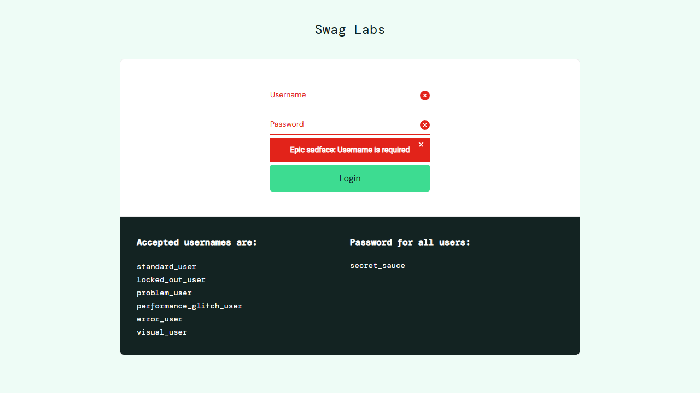
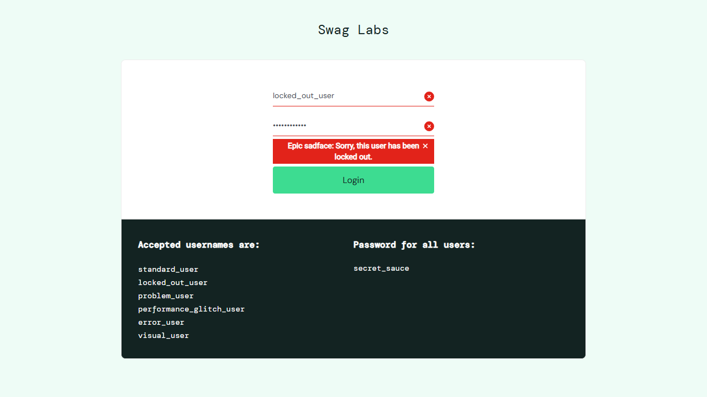
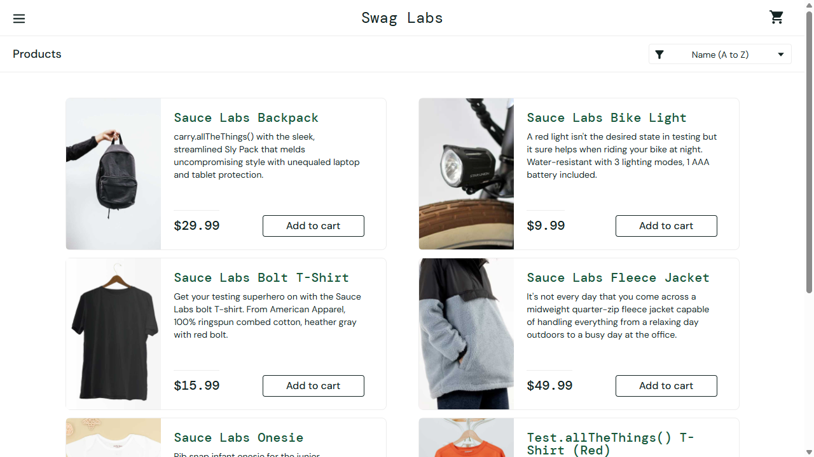
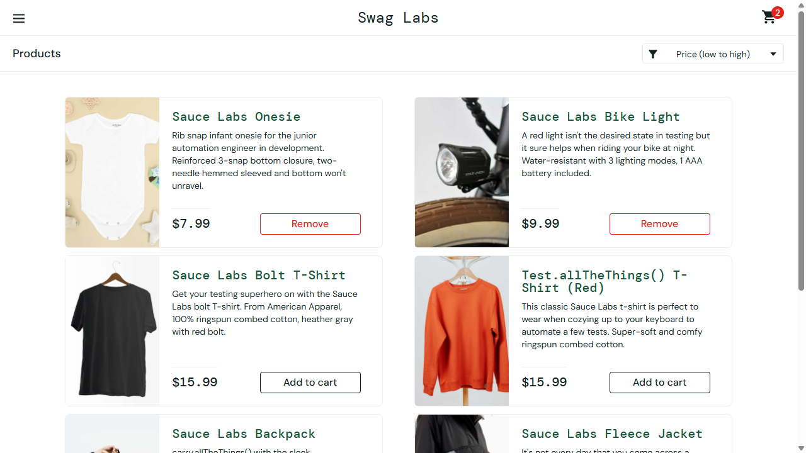
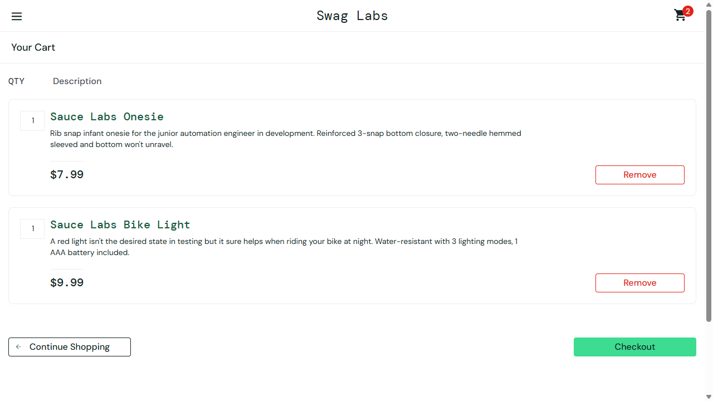
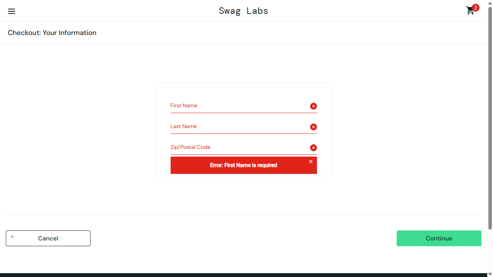
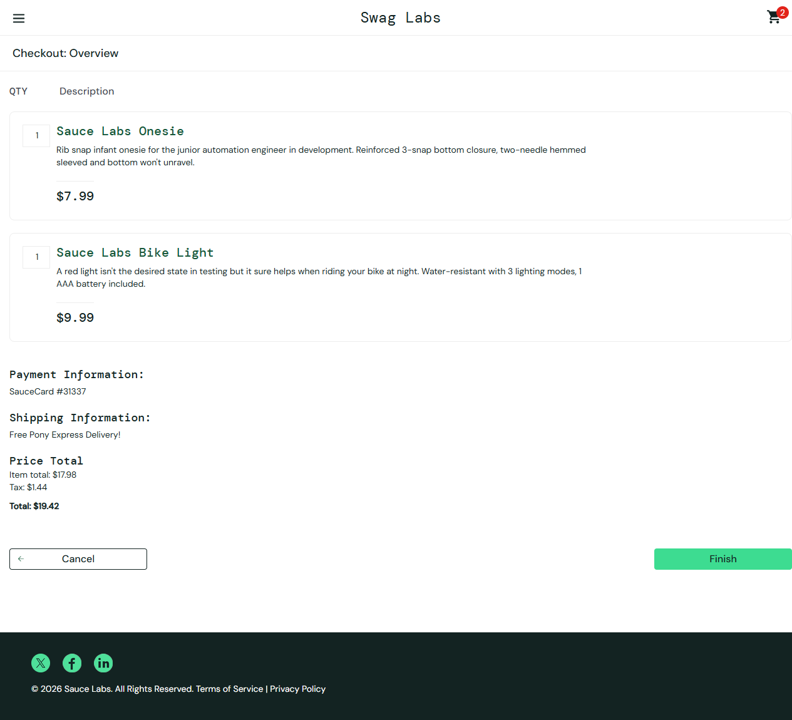
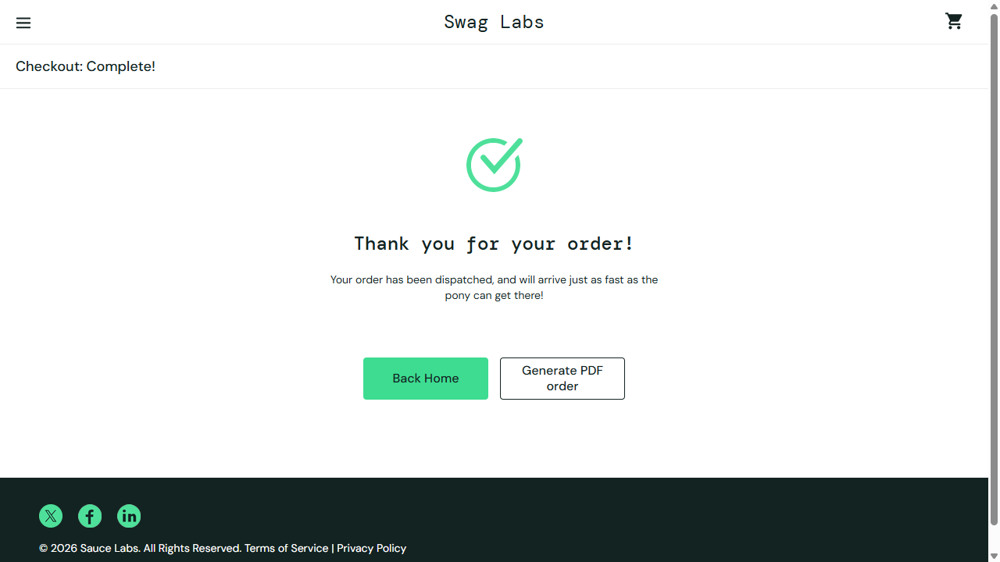

# Manual Test Report: SauceDemo Critical Workflows

- **Site:** https://www.saucedemo.com
- **Date:** 2026-10-30
- **Tool:** Playwright MCP (Chromium)
- **Result:** All 8 scenarios passed. 2 minor observations, no functional defects.

## Scenarios

### 1. Login validation: empty submit
- **Steps:** Open `/`, click **Login** with both fields empty.
- **Outcome:** Alert (`role=alert`) shows "Epic sadface: Username is required". User stays on `/`.
- **Screenshot:** 

### 2. Login: locked-out user
- **Steps:** Enter `locked_out_user` / `secret_sauce`, click **Login**.
- **Outcome:** Alert shows "Epic sadface: Sorry, this user has been locked out." No navigation.
- **Screenshot:** 

### 3. Login: standard user
- **Steps:** Enter `standard_user` / `secret_sauce`, click **Login**.
- **Outcome:** Redirected to `/inventory.html`. Six products shown with names, descriptions, prices, images and **Add to cart** buttons. Cart badge empty.
- **Screenshot:** 

### 4. Sort and add to cart
- **Steps:** Choose "Price (low to high)" in the "Sort products" combobox; add Sauce Labs Onesie and Bike Light.
- **Outcome:** Order became $7.99, $9.99, $15.99, $15.99, $29.99, $49.99 (correct). Cart badge shows 2, and the button label for each added item changes.
- **Screenshot:** 

### 5. Cart review
- **Steps:** Open the cart (`/cart.html`).
- **Outcome:** Both items listed with QTY 1, correct prices, **Remove**, **Continue Shopping** and **Checkout** present. Accessible name "Cart, 2 items".
- **Screenshot:** 

### 6. Checkout information validation
- **Steps:** Click **Checkout**, then **Continue** with an empty form.
- **Outcome:** Alert "Error: First Name is required". Stays on `/checkout-step-one.html`.
- **Screenshot:** 

### 7. Checkout overview and totals
- **Steps:** Fill First Name `Test`, Last Name `User`, Zip `75500`, click **Continue**.
- **Outcome:** `/checkout-step-two.html` shows both items, payment (SauceCard #31337), shipping, Item total $17.98, Tax $1.44, Total $19.42. Arithmetic is correct (7.99 + 9.99 = 17.98; 8% tax = 1.44).
- **Screenshot:** 

### 8. Order completion, logout, session protection
- **Steps:** Click **Finish**, open the menu, click **Logout**, then navigate directly to `/inventory.html`.
- **Outcome:** "Thank you for your order!" shown on `/checkout-complete.html`, cart reset to empty. Logout returns to `/`. Direct access to `/inventory.html` while logged out redirects to the login page.
- **Screenshot:** 

## Issues and Observations

1. **Console errors (low, third-party):** Repeated `401 Unauthorized` on `events.backtrace.io` (summed-events / unique-events) with placeholder `universe=UNIVERSE&token=TOKEN`. This is the site's error-reporting telemetry being misconfigured. No user-visible effect.
2. **Browser hint (low):** Chrome logs "Input elements should have autocomplete attributes (suggested: `current-password`)" for the password field on the login page.
3. **Accessibility notes (positive):** Errors use `role=alert` with a "Dismiss error" button; form has an accessible name ("Login", "Checkout information"); images have alt text; cart exposes item count in its accessible name. Not tested: keyboard-only navigation, colour contrast, screen reader output.

## Not Covered
`problem_user`, `performance_glitch_user`, `error_user`, `visual_user` behaviours; remove-from-cart; product detail pages; wrong-password login; mobile viewports.
